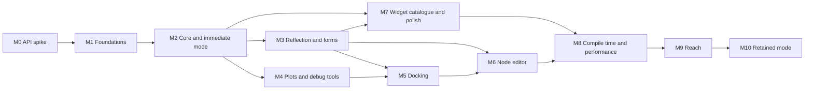

# Roadmap: `std::ui`

> **Status:** proposal. It plans the work for [draft 35](35-ui.md); section numbers (§) refer to that draft.
> **Based on:** draft 35, `docs/compiler/spec-34-status.md` (what edaxc does today) and the current `library/std` (windowing, graphics, log; no `std::math`, `std::image` or fonts yet).

---

## 0. How the work is cut

- **Milestones, not dates.** Each milestone ends with something you can use, not with a layer that waits for the next one.
- **Dogfood from the second milestone on.** `example/windowing` gets a real debug overlay in M2; from then on, every milestone adds to two examples:
  - `example/ui_gallery`: every widget, every theme, every plot kind. It is also where screenshot tests are taken.
  - `example/editor`: grows into the editor of the mockups: docking, outliner, inspector, console, frame time, a material graph.
- **Every milestone is finished the same way:** the draft's sections for it become design pages under `docs/design/stdlib/ui/` (Rules / Examples / Rationale), with feature tests, `action/` tests, the gallery updated, and a line in a status file `docs/compiler/ui-status.md` (same format as `spec-34-status.md`).
- **Sizes** are rough estimates of focused work for one person: **S** under a week, **M** 1-3 weeks, **L** 3-6 weeks, **XL** more than 6 weeks.

M4 and M7 can run beside M3, M5 and M6; the arrows are the hard dependencies.

---

## 1. Dependencies outside `std::ui`

| Needed | For | Today | Plan / fallback |
|---|---|---|---|
| `std::math`: `vec2/3/4`, `rect`, `color` (sRGB ↔ linear, OKLCH), `mat3` for 2-D transforms | Everything | Missing (first on the engine list) | Build the subset the UI needs in M1, inside `std::math`, not in `std::ui` |
| `std::image`: `rgba8`, PNG (inflate) and QOI decoding | Images, icons, textures | Missing | M1, run time first; compile time in M8 |
| `std::text::font`: TrueType reading, glyph outlines, distance-field rasterization, atlas packing | Text | Missing | M1 with single-channel SDF; MSDF in M7 |
| Windowing: clipboard text, cursor shapes, text input / IME area, content scale | Text fields, HiDPI | `set_cursor(shape)`, `content_scale()`, `event::text` exist; clipboard and IME area to check | Add what's missing in M1 (small, X11 only) |
| Windowing: `popup(owner)` windows in the same share group | Docking across OS windows | `window::config.kind` exists | M9 |
| Annotations, `std::meta::fields/methods/alternatives`, `functions_with`, `types_with`, `std::call_site`, `implicit` parameters | Reflection, ids, command palette | Done | - |
| `compile_time std::static_str` parameters checked against field names | `w.field(mut p, "speed")`, form methods | Compile-time parameters exist | Spike in M0 |
| `std::inline_function`, `std::function` with bounds | Rules in forms, own widgets in widget sets | Done | - |
| `std::embed` | Fonts, icons, images in the binary | Done | - |
| `@std::hot_reload_state` | UI state that survives a plugin reload | Done | Use in M5 for the dock layout and in M8 for the context |
| **Fast compile-time evaluator** (bytecode) | Baking fonts and decoding images at compile time | Designed, not implemented (the tree-walking evaluator is too slow for megabytes of font data) | Bake at run time until then; M8 switches when the evaluator lands. A build step in `build.ed` is the middle option |
| **Compile-time values as static data** | `compile_time ui::form<T>` constants and compile-time atlases used at run time | Designed, not implemented (`std::embed` materializes byte data only) | Forms are built at run time (a small table, once per call) until then |
| Extension methods, or a widget interface (open question 2) | Own widgets with the same call syntax as the library's | Not designed | Decide in M0; free functions work without it |

The UI needs no compiler work to start. Two compiler items, the bytecode evaluator and compile-time values as static data, only make things faster or cheaper, and both have a fallback.

---

## 2. Milestones

### M0: API spike (S): **done**, see `example/ui_spike/README.md`
Prove the parts of the design that depend on the language before building on them.
- A throwaway `im::context` / `im::frame` / `im::scope` with three widgets (`text`, `button`, `slider`) drawing coloured rectangles through the existing GL code of `example/windowing`.
- Check that **scopes borrowing their parent mutably** read well in real code: nested containers, loops with `id(key)`, early `return`, helper functions taking `mut im::scope&`, widgets editing fields of state the program also uses in the same frame.
- Check **ids from `implicit compile_time std::call_site`**: equal labels in different places, loops, helpers called from two places.
- Check **field names as `compile_time std::static_str`**: `w.field(mut p, "speed")` with an error at the call for a wrong name; a form method `.range("speed", ...)` returning a changed form.
- Decide open questions 2 (own widgets as methods), 3 (scopes vs. lambdas), 4 (one-pass layout) and 6 (where fonts live).

**Done when:** the spike compiles and runs, the decisions are written into draft 35, and any compiler bug it found is fixed or filed.

**Result:** every point worked. Two compiler bugs were fixed (`implement` members with `compile_time` parameters; qualified constants as template value arguments), questions 2, 3, 4 and 6 are decided, and the std gaps found (`std::format_into`, `span::as_ptr`, byte access on `std::str`) are added to M1.

### M1: Foundations (L): **mostly done**, see `docs/compiler/ui-status.md`
- `std::math` subset; `std::image` (PNG, QOI, `rgba8`); windowing additions (clipboard, IME area).
- Small std additions found in M0: `std::format_into(mut std::string&, std::format_args)`, `std::span<T>::as_ptr()`, safe byte access on `std::str`.
- `std::text::font`: TrueType tables (`cmap`, `glyf`, `loca`, `hmtx`, `kern`/`GPOS` pairs), outline flattening, single-channel SDF rasterization, atlas packing, **baked at run time**.
- `std::ui` core: `draw_list` / `draw_data` (one vertex format: position, uv, colour, shape parameters), the **painter** (rounded rectangles with per-corner radii, circles, lines, borders, shadows, linear gradients, images, text), clip rectangles.
- `ui::opengl::renderer<A>`: one shader, one draw call per texture and clip.
- Themes: tokens (§3.1), `ui::theme::dark()`, `light()`, `from_accent` (OKLCH).
- Bundled assets: one sans-serif in two weights, one monospace (open licences, licence files in the tree).

**Done when:** `example/ui_gallery` shows a static card with text in three roles, a rounded shadowed button shape and an image, sharp at content scale 1 and 2; `draw_data` golden tests pass without a GPU.

### M2: Core and immediate mode (L): **done** (`split` moved to M5), see `docs/compiler/ui-status.md`
- `im::context`, `im::frame`, `im::scope`, ids, the duplicate-id check (debug modes).
- Input: `wnd::input_layer`, `wants_mouse` / `wants_keyboard`, focus, keyboard navigation (Tab, arrows, Enter, Esc).
- Layout (§4): column/row, gap, padding, align, `px`/`fit`/`fill`/`percent`, `scroll`, `grid`.
- The own-widget API (§11): `make_id`, `allocate`, `interact`, `animate`, `state<T>`, `painter`, `theme`, `tooltip`, `focus_ring`. **Every widget below is written with it**, which checks that it suffices.
- First widgets: `text` roles, `button` (variants, icons later), `checkbox`, `toggle`, `slider`, `drag`, `number`, `input_text` (with `ui::text_edit`: cursor, selection, clipboard, undo), `combo`, `window`, `section`, `tree`, `card`, `separator`, `tooltip`, `progress`.
- Scoped style changes (§3.3), animations for hover/press/open.
- **Dogfood:** replace `debug_overlay_stub` in `example/windowing`.

**Done when:** the windowing example has a usable overlay (toggle with F1, fps, sliders on the demo's state); input replay tests cover focus, dragging and text editing; no allocation per frame after the first frames (counted with a test allocator).

### M3: Reflection and forms (L): **done** (a few small items open, see `docs/compiler/ui-status.md`)
- `ui::form<T>`: `annotated()`, the field methods of §7.8.1, paths (`"a.b"`, `"list[].x"`), built at run time (see §1 of this roadmap).
- `inspect`, `field`, the type → widget table of §7.2, the `@ui::*` annotations with their compile-time checks (§7.3).
- `ui::edit` with the changed field and `committed()`; `ui::undo_history<T>`.
- Rules (§7.8.3) with `ui::rules::*`; scoped forms `with_form`, `ctx.set_form`, the precedence of §7.8.4.
- Widget sets `tool` and `touch` (§7.8.5); `gamepad` in M7.
- `w.table(span)` from fields: sorting, filter, selection, **virtualized rows**; `tabs<E>`, `segmented<E>`, `combo<E>`, `radio<E>`.
- `ui::inspectable` and `@ui::field_widget` for types the program doesn't own.
- Decide open questions 5 (`@ui::visible_if`) and 9 (field names as strings or language field references).

**Done when:** `example/editor` shows its player and vehicle structs in two forms (the mockup of §7.8.2); `action/check` tests cover every annotation error and every misspelled field or path; a 100 000-row table scrolls at full frame rate.

### M4: Plots and debug tools (M)
Can start right after M2, beside M3.
- `ui::plot`: `history<T, N>`, `line`, `scatter`, `bars`, `area`, `hline`/`vline`; axes (linear, log, time), ticks, legend, hover tooltip, pan/zoom/fit, linked axes; per-pixel min/max decimation.
- Plotting structs by reflection (`@plot::x`, `@plot::series`).
- `sparkline`, `stat`.
- Debug tools: `perf_overlay`, `log_view` (a `std::log` sink), `texture_viewer`.

**Done when:** the editor's frame-time plot and console work as in the mockup; a series of 1 000 000 points draws in under 1 ms (decimation measured in `bench/`).

**Status (2026-11-25):** done, see `docs/compiler/ui-status.md` and [Plots and debug tools](../stdlib/ui/plots.md).
- The frame-time plot, the console (`log_view`) and `perf_overlay` are in `example/ui_plots`.
- Reducing a million points takes 1.4 ms (`bench/plot_decimate`; the same algorithm in C++ takes 4.4 ms). Getting under 1 ms needs SIMD in the column scan, which belongs to M8.
- Left for later: time axes and `texture_viewer`.

### M5: Docking (L)
- `dock::layout` as data (`split_x`, `split_y`, `tabs`, `central`, `floating`), `to_text`/`from_text`, built in code.
- `f.dockspace`, `space.window(name)`, `space.document(name)`; tab bars, splits with dividers, closing and reopening in the last place.
- `w.split(...)` inside a window (two panes with a draggable divider, from M2): the same divider code as the dock splits.
- Drag and drop with drop targets and preview (§12.2), Shift for floating.
- Workspaces (`save_as`, `switch_to`); the layout survives a plugin hot reload (`@std::hot_reload_state`).
- Decide open question 1 (stable ids across edits) for state that isn't a named window.

**Done when:** `example/editor` has the mockup's layout, saved and restored between runs; replay tests drag every window into every drop target.

**Status (2026-11-25):** done, see `docs/compiler/ui-status.md` and [Docking](../stdlib/ui/docking.md).
- `example/editor` is docked and keeps its layout in `editor.layout`.
- `action/run/std_ui_dock` drops each of 6 windows onto every target: 180 drops, and the layout stays consistent after each one.
- Open question 1 is decided for docked windows: names are their ids.
- Not done: the menu bar (M7), Shift to float, tab overflow and pinning, and compile-time layouts.

### M6: Node editor (L)
**Status (2026-11-25):** done, see `docs/compiler/ui-status.md` and [Node editor](../stdlib/ui/nodes.md).
- §13.1 with styles (five presets, subway links in 8 directions), links in box selections, collapsing, reroute points, arranging and inline pin widgets.
- §13.2: `nodes::graph<K>` and `graph_editor`; the material graph of `example/editor` can be built from an empty canvas with the mouse and keyboard, saved, reloaded and compiled; a cycle is reported with the node's id.
- Not done: subgraphs, find node, `nodes::custom_body`, `evaluate()`; open question 11 stays open (the graph is plain data, so both answers work).
- `nodes::editor` (§13.1): canvas (pan, zoom, grid), nodes with `im::scope` bodies, pins, links, selection, `nodes::edits`, comment frames, reroutes, minimap.
- `nodes::graph<K>` (§13.2): kinds from an enum, pins from `@nodes::in/out`, parameters with `inspect` and forms, type checks with `nodes::converts`, the add-node menu (filtered while dragging a link), copy/paste as text, undo, saving, `topological_order()`.
- Decide open question 11 (graph evaluation: interpreter interface only, or also a build step).
- **Example:** a material graph in `example/editor` whose result is GLSL, recompiled on change.

**Done when:** the material graph of the mockup can be built from an empty canvas with the mouse and keyboard only, saved, reloaded and compiled; cycles are reported at the node.

### M7: Widget catalogue and polish (L, can be split)
- The rest of §9: colour picker (OKLCH), toasts, `confirm`, modal, drawer, menus and context menus, command palette from `@ui::command`, `rich`, `markdown`, chips, range slider, knob, hotkey, `empty_state`, `skeleton`, `breadcrumbs`.
- Icons: the bundled icon set and `ui::icons::*`.
- MSDF text (sharp corners at large sizes); `gamepad` widget set and gamepad navigation.
- `theme_editor`, `ui_inspector` (shows which form layer each property came from), the contrast check for themes.

**Done when:** every row of §9 is in the gallery with a screenshot test.

### M8: Compile time and performance (M, after the compiler work)
- Compile-time font atlases and `std::image::decode_png` at compile time, once the bytecode evaluator exists.
- `compile_time ui::form<T>` constants, once compile-time values can be static data.
- `bench/ui`: building and drawing the same 2 000-widget frame with Dear ImGui (C++) and `std::ui`; the goal is to be no slower, as with the rest of the library.
- SIMD for decimation and vertex generation; the frame allocator checked with the test allocator in CI.

**Done when:** the benchmark runs in CI and the start-up cost of fonts is zero in the editor example.

### M9: Reach (XL, follows the platform work)
- `ui::vulkan::renderer<A>`.
- Docking across OS windows (`popup(owner)` windows, shared fonts and textures).
- New platforms follow `std::windowing` (Wayland, Windows, macOS): `std::ui` itself has no platform code.
- Text shaping and colour emoji as packages behind `ui::font_source`; subgraphs in `nodes::graph<K>`.

### M10: Retained mode (XL)
- Decide open question 7 (imperative or declarative) with a spike like M0.
- `rt::tree`, typed handles, pulled events, redraw on change, layout with a measure pass, `rt::form<T>` on the same forms, `rt::immediate_panel`, a retained tree as dock content (open question 10).
- **Example:** a game main menu and settings screen built in retained mode, inside the editor's game view.

---

## 3. Testing

| Kind | What it checks | Runs |
|---|---|---|
| Unit tests (`@std::test`) | Layout, text measurement, themes, form building and precedence, dock layout operations, graph operations | Everywhere, no window |
| `draw_data` golden tests | Hashes of the draw data of gallery pages: catches visual changes without a GPU | Everywhere |
| Input replay tests | A scripted `ui::input` sequence (clicks, drags, keys, text) against a frame function; assertions on the program's state afterwards | Everywhere |
| Screenshot tests | Gallery pages rendered with Mesa `llvmpipe` under Xvfb, compared with a tolerance | Linux CI |
| `action/check` tests | Every compile error of annotations, forms and node kinds: message, location, note | Everywhere |
| Benchmarks | Frame build time vs Dear ImGui, plot decimation, table virtualization, allocations per frame | `bench/`, CI |

---

## 4. Decision points

| Open question (draft 35 §17) | Decide in | Because |
|---|---|---|
| 2 Own widgets as methods | M0: **`implement` for `im::scope`** | Changes how every widget of M2 is written |
| 3 Scopes vs. lambdas | M0: **scopes** | The shape of every container |
| 4 One-pass layout | M0: **one pass** | Layout code in M2 |
| 6 Where fonts and images live | M0: **`std::text::font`, `std::image`** | Module layout of M1 |
| 5 `@ui::visible_if` | M3 | Part of the annotation set |
| 9 Field names as strings or field references | M3 | Strings work now; a language field reference would be a compiler item |
| 1 Stable ids across edits | M5 | Saved UI state beyond named windows |
| 11 Graph evaluation | M6 | Shape of `nodes::graph<K>`'s API |
| 8 Ranges as values | When range expressions become values | Only adds an overload |
| 7 Retained: imperative or declarative | M10 | Not needed before |
| 10 Docking and retained mode | M10 | Not needed before |

---

## 5. Risks

| Risk | Effect | Mitigation |
|---|---|---|
| Scopes that borrow their parent feel heavy in real code | The main API change against ImGui doesn't work out | M0 tests it on real panels before anything depends on it; lambdas are the fallback (question 3) |
| Compile times of `inspect` over many types | Slow editor builds | Measure in M3 with the object cache's statistics; keep the per-type code small (forms are data, widgets are shared, only the field walk is per type) |
| Font rendering quality (hinting, small sizes, MSDF artefacts) | Text looks worse than ImGui's bitmap fonts at 13 px | SDF with a per-size atlas for small sizes; MSDF only for large sizes and zoomed canvases (node editor) |
| Compile-time evaluator too slow for baking | Long builds | Run-time baking until M8 (§1) |
| The widget catalogue grows without end | Milestones never finish | §9 is the list for 1.0; anything else goes to packages built on the public API |
| Only X11 today | The UI can't be used on Windows/macOS | `std::ui` has no platform code; it follows `std::windowing` |
