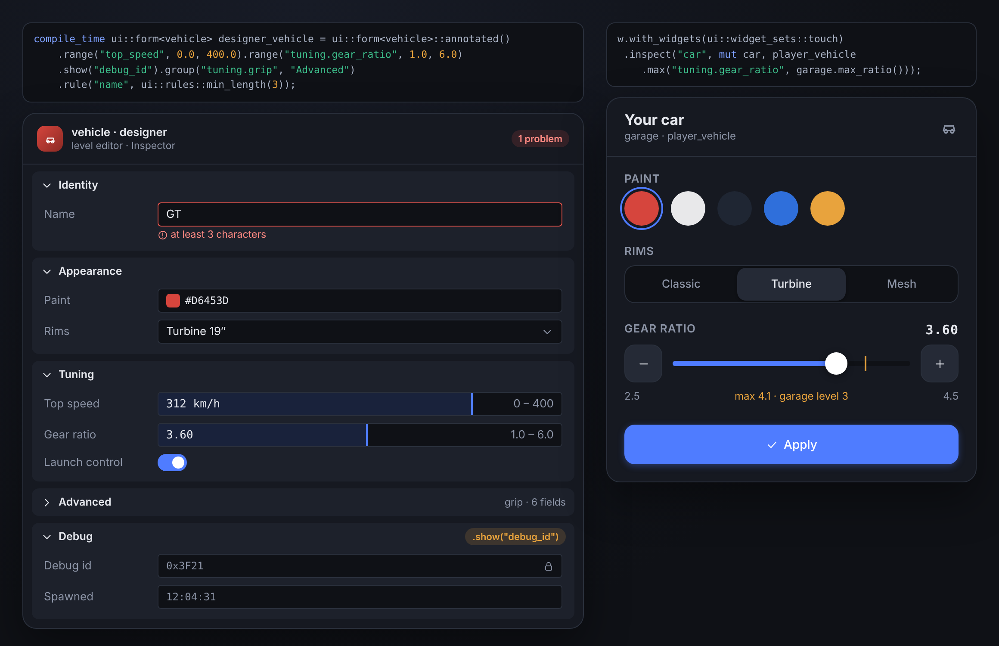
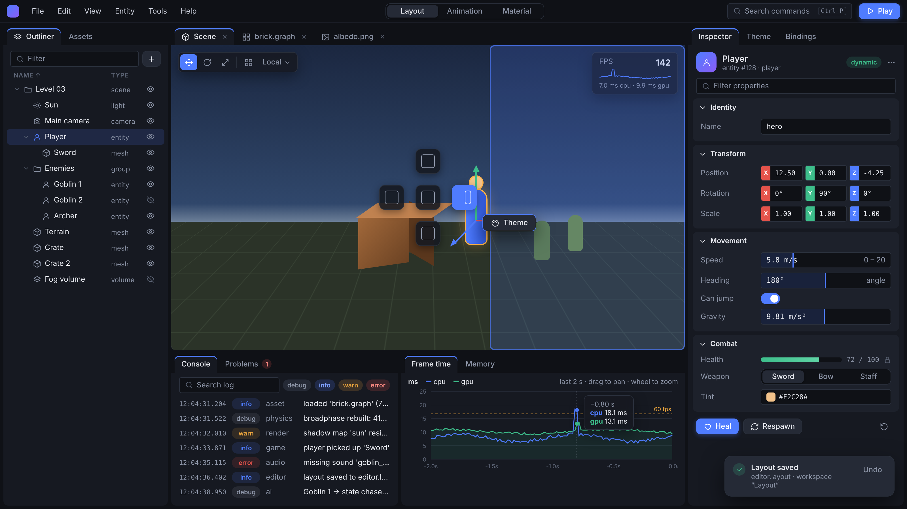
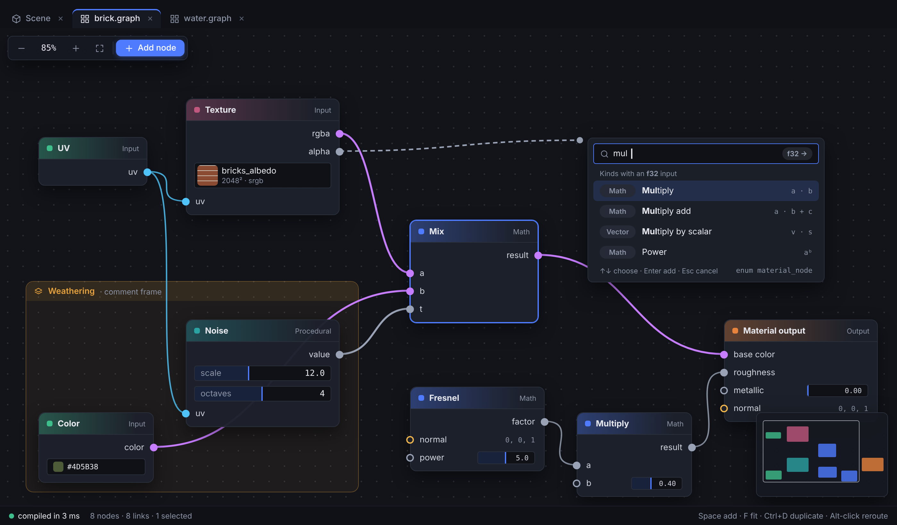

# Draft 35: User interfaces, `std::ui`

> **Status:** draft for review. Nothing here is implemented. It becomes `stdlib/ui/*.md` once decided.

`std::ui` draws user interfaces into a window: debug overlays and tools, editors, menus and HUDs. It is part of the standard library, written in Edax on `std::windowing` and `std::graphics`, with no outside dependencies.

---

## 0. Goals

Lessons from Dear ImGui, which is the model for the immediate-mode half:

| With ImGui | In `std::ui` |
|---|---|
| Every struct needs a hand-written editor, kept in sync with the struct by hand | **Reflection first.** `w.inspect(mut value)` builds the editor from the type at compile time; annotations on fields tune it (§7) |
| A modern look needs a pile of helpers and style pushes/pops | **Modern by default.** A theme made of design tokens, rounded and shadowed shapes, smooth animation, crisp scalable text and icons. One accent colour gives a complete theme (§3) |
| Common widgets (toggle, search field, card, toast, command palette) are missing or third-party | **Batteries included:** a catalogue of composed widgets (§9) |
| Plots need ImPlot, images need a loader and backend glue | **Text, images and plots are part of the library from the start** (§5, §6, §8) |
| `Begin`/`End` and `Push`/`Pop` mismatches, id collisions from equal labels | Scopes that the borrow checker closes, ids from call sites (§10) |
| Writing an own widget needs internal headers | **Own widgets use the same public API as the library's** (§11) |
| Annotations fix one set of ranges per type | **Forms are values:** a context overrides ranges, defaults, rules or the widget of any field, for one call, a scope or the whole program (§7.8) |
| Docking lives on a branch, node editors are third-party | **Docking (§12) and a node editor with a ready-made graph (§13) are part of the library** |

### Open and capable
Every layer is reachable and replaceable; nothing the library's own widgets use is private:

| Layer | Open because |
|---|---|
| Draw output | `ui::draw_data` is plain data: any renderer, recording, tests |
| Renderers | Small, documented; write one for your engine's own pipeline |
| Themes | Plain structs: build, interpolate, save, edit live |
| Widgets | §11: the same calls the library uses |
| Reflection | `ui::form<T>` is a value you can read, change and build yourself (§7.8) |
| Widget choice per kind | `ui::widget_set`: replace the widget used for any field kind, per scope (§7.8.5) |
| Docking | The layout is a tree of plain data: build in code, save as text, restore (§12) |
| Node editor | Two layers: an immediate editor over **your** data, and a default graph on top of it that you may skip (§13) |

Non-goals for the first version: a native-looking UI (OS widgets), full text shaping (Arabic, Indic scripts), a web-like CSS cascade.

---

## 1. One setting or two namespaces?

**Two front-ends in two namespaces on one shared core, not a build setting.** `std::ui::immediate` comes first, `std::ui::retained` later.

1. **Two programming models, not two implementations.** In immediate mode `w.button("Save")` runs every frame and returns what happened this frame; in retained mode a button is made once and reports clicks later. A setting that changes what a call *means* breaks principles 1 and 2: a reader couldn't tell which model a line is written in.
2. **A setting is per target, so it breaks libraries.** A package's immediate debug panel stops compiling when the application chooses retained.
3. **Programs want both:** an immediate debug overlay *and* a retained menu, HUD or editor.
4. **Same decision as windowing:** a window's kind is its type, not a setting. The UI's model is the type you create (`im::context` or `rt::tree`).

Everything that makes a UI look good and saves work is in the shared core and used by both: themes, layout, text, images, the reflection layer, plots, renderers. Compile-time values pick *values within one design*: whether the program has a debug UI at all (the program's own setting), the duplicate-id checks (follow the build mode), the font atlas (a `compile_time` value), the renderer (its type).

---

## 2. Architecture

```
          std::ui::immediate                         std::ui::retained (later)
                    \                                     /
   std::ui::dock, std::ui::nodes  (docking; node editor and graph)
                     \                                   /
   std::ui::plot ─── std::ui::form ──────────────────────          (plots; reflection → forms)
                     \                                   /
   std::ui (core): theme, layout, text, images, input, ids, animation, painter, draw lists
          |                                  |                         |
std::ui::opengl / ::vulkan            std::text::font             std::image
  (renderers)                          (TrueType, MSDF atlas,       (PNG, QOI decoding;
                                        icons)                       also for the game)
          |
std::windowing, std::graphics
```

- **`std::ui` (core)** knows nothing about immediate or retained mode. It turns shapes, text and images into `ui::draw_data`: plain data, sendable, testable without a GPU.
- **`std::ui::form`** is the reflection layer: `ui::form<T>` describes each field of `T` (widget kind, label, range, unit, default, rules, group, tooltip...). It starts from the annotations and can be changed per context (§7.8). Both front-ends render the same forms.
- **`std::ui::dock`** and **`std::ui::nodes`** are built on the immediate front-end's public API; their data (`dock::layout`, `nodes::graph<K>`) is plain and front-end independent.
- **`std::ui::plot`** draws charts with the core's painter. Its immediate API is in `ui::plot`, and it is used from an immediate scope (§8).
- **Renderers** draw `ui::draw_data` with one shader and one vertex format; `ui::opengl::renderer<A>` first, `ui::vulkan::renderer<A>` later.

---

## 3. A modern look

### 3.1 Themes are design tokens
A theme is a plain struct of **tokens**: named colours, sizes and timings. Widgets never use a raw number; they ask the theme for `space.m` or `colors.surface`, so one change restyles everything consistently.

```edax
struct theme {
    ui::palette    colors;         // roles, not widgets: background, surface, surface_raised, primary,
                                   // on_primary, text, text_muted, border, focus, success, warning, danger
    ui::type_scale text;           // caption, body, label, title, heading, display: size, weight, line height
    ui::spacing    space;          // xs 4, s 8, m 12, l 16, xl 24, xxl 32 (logical pixels)
    ui::radii      radius;         // none, small 4, medium 8, large 12, full
    ui::elevation  shadow;         // level 0-3: offset, blur, colour
    ui::motion     motion;         // fast 80 ms, normal 160 ms, slow 280 ms, easing
    f32            density;        // 1.0 comfortable; 0.8 compact (tools); 1.2 touch / TV
}
```
- **From one colour:** `ui::theme::from_accent(ui::color::hex(0x6750A4), ui::brightness::dark)` derives the whole palette (surfaces, text contrast, hover and press shades, disabled colours) in a perceptual colour space (OKLCH), so contrast stays readable. `ui::theme::dark()` and `light()` are ready-made.
- **Themes are values:** they can be interpolated (`ui::theme::mix(a, b, t)` for an animated light/dark switch), compared, built at compile time and, because every token is a field, **edited live with `w.inspect(mut ctx.theme())`**: the theme editor is free.
- **Contrast check:** in `debug`-based modes a theme whose text/background pairs are below WCAG AA (4.5:1) logs a warning naming the pair.

### 3.2 Variants instead of colour pushes
Widgets that come in kinds take a `ui::variant`: `primary`, `secondary` (the default), `ghost`, `outline`, `danger`, `success`. Edax has no default arguments, so every widget has a short form and a form with an options struct:
```edax
if (w.button("Save")) { ... }
if (w.button("Delete", ui::button{ .variant = ui::variant::danger, .icon = ui::icons::trash })) { ... }
```

### 3.3 Scoped style changes
A style change is a scope like any other container, so it can't be left pushed:
```edax
{
    mut im::scope small = w.style(ui::style_change{ .density = 0.8, .text = ui::text_role::caption });
    small.text(f"{entity_count} entities");
}   // back to the parent's style here
```

### 3.4 Shapes, shadows and motion
- **Every shape is anti-aliased and may be rounded:** rectangles with per-corner radii, circles, lines with caps, arcs, paths. Edges are signed-distance shapes computed per pixel in the shader, so they stay sharp at any scale with four vertices per shape.
- **Shadows, glows and gradients** (linear, radial) are as cheap as a filled shape; `ui::elevation` uses them.
- **Animation is built in:** hover, press, focus, open/close and value changes are interpolated with the theme's `motion` timings, per widget id, without code in the program. Own widgets use `s.animate(id, target)` (§11). `motion` with all durations 0 turns it off (reduced motion).
- **HiDPI is automatic:** all sizes are logical pixels × the window's content scale; text and icons are rendered from distance fields, so a scale change re-lays out but doesn't re-rasterize.

### 3.4a The shapes of controls and replaceable painters (decided in M2)
The look is not fixed to what the library draws: it has two replaceable layers.
- **Component tokens** in the theme (`theme.controls`): button height and padding, slider knob size and shape (`knob_shape::circle`, `square`, `diamond`, `star`, `bar`), toggle and checkbox sizes, the checkbox mark (`tick_shape::tick`, `cross`, `square`, `dot`), window title and padding, and `boolean`: whether a bool is a toggle or a checkbox where the code doesn't say. Corner presets: `ui::radius_scale::rounded()`, `subtle()`, `sharp()`.
- **A skin**: one painter function per kind of widget (`std::function<void(mut ui::painter&, ui::slider_part&)>` and so on) that the program replaces. A widget decides (layout, hit testing, value); the painter gets a *part* (bounds, value, animated hover/press) and only draws. `ui::paint::*` are the library's painters, which a replacement can call and add to.
```edax
ctx.skin().slider_knob = [](mut ui::painter& p, ui::slider_part& k) {
    ui::paint::knob(mut p, ui::knob_shape::star, k.knob_center(), 20.0, p.tokens.colors.warning, p.tokens.colors.text);
};
```
Pages: [core.md, Changing the look](../stdlib/ui/core.md#changing-the-look); example: `example/ui_widgets`.

### 3.5 One draw call
All of this is one vertex format (position, uv, colour, shape parameters) and one shader. A frame is one draw call per texture and clip rectangle, as with ImGui, even with rounded corners, shadows and text.

---

## 4. Layout

ImGui places widgets with a cursor; a modern look needs alignment, gaps and filling. `std::ui` uses a small **flex model**:

- A container stacks its children in a **column** (default) or a **row**, with `gap`, `padding` and `align` (`start`, `center`, `end`, `stretch`) from the theme's spacing tokens.
- Each child's size along the main axis is `ui::px(n)`, `ui::fit` (its content), `ui::fill(weight)` (a share of what's left) or `ui::percent(p)`. The cross axis is `fit` or `stretch`.
- `w.grid(columns)`, `w.split(ui::split{ .ratio = 0.3, .resizable = true })` (two panes with a draggable divider), `w.scroll()` (a scroll area), `w.wrap()` (a row that wraps, for chips and tiles).
- **One pass:** `fit` uses the size measured in the previous frame, as ImGui does; a new widget is measured in its first frame and shown from the second. `w.layout_now()` forces a measure pass for a container whose first frame must already be right (a popup).
```edax
{
    mut im::scope bar = w.row(ui::row{ .gap = ui::gap::s, .align = ui::align::center });
    bar.icon(ui::icons::search);
    bar.width(ui::fill(1)).search("filter", mut filter);       // takes what is left
    if (bar.button("Clear", ui::button{ .variant = ui::variant::ghost })) { filter.clear(); }
}
```
- `s.width(size)` / `s.height(size)` return a one-widget view of the scope that sizes the next widget.

---

## 5. Text

- **Roles, not sizes:** `w.text(f"...")` uses `body`; `w.heading(...)`, `w.title(...)`, `w.label(...)`, `w.caption(...)` use the theme's type scale. A role is also an option (`ui::text{ .role = ..., .color = ui::color_role::text_muted }`).
- **Formatting without allocation:** text takes `std::format_args`; `f"..."` holes are formatted straight into the draw list.
- **Wrapping and overflow:** `wrap` (at word boundaries), `ellipsis` (`…` at the end or in the middle, for paths), `clip`. Alignment start/center/end.
- **Rich text:** `w.rich(ui::spans{ ... })` mixes roles, colours, bold/italic, inline icons and inline code in one paragraph. `w.markdown(text)` renders a small subset (headings, emphasis, lists, code, links) for help pages and tooltips.
- **Selectable text:** `ui::text{ .selectable = true }` allows selecting and copying read-only text (log lines, error messages).
- **Editing:** `input_text`, `input_multiline`, `search` (with icon and clear button), numeric fields with units. All share `ui::text_edit`: UTF-8 cursor movement by grapheme, word jumps, selection, undo/redo, clipboard, IME position.
- **Fonts:** see §15. Unicode text is laid out per code point with kerning; shaping (ligatures, complex scripts) is a later package.

---

## 6. Images

```edax
// at compile time: decoded and embedded in the binary
compile_time std::image::rgba8 logo_pixels = std::image::decode_png(std::embed("assets/logo.png"));

// once: a texture the renderer owns
ui::texture logo = renderer.upload(logo_pixels);
ui::texture scene = ui::texture::from_gl(game.color_attachment, game.size);   // the game's own texture

w.image(logo, ui::image{ .size = ui::size{ .width = 128, .height = 128 }, .radius = ui::radius::large });
w.image(scene, ui::image{ .fit = ui::image_fit::contain });                     // the viewport of an editor
if (w.image_button(icon_atlas, ui::image{ .uv = slot_uv(3) })) { ... }
w.texture_viewer("shadow map", shadow_map);                                    // zoom, pan, channels, pixel values
```
- **`ui::texture`** is a renderer's handle plus size. `renderer.upload(image)` makes one from an `std::image::rgba8` (or a `wnd::image`); `ui::texture::from_gl(name, size)` / `from_vulkan(view, sampler, size)` wrap the program's own textures, which the program keeps alive while the UI shows them.
- **`std::image`** (new, shared with the game): `rgba8` (plain data, sendable), `decode_png`, `decode_qoi`, `encode_png`. Decoding works at compile time, so `std::embed` + `decode_png` puts ready pixels into the binary. JPEG, KTX2 and others come as packages.
- **Fit:** `contain`, `cover`, `fill`, `none`; `uv` for a part of an atlas or a sprite sheet; `tint`; rounded corners and borders like any shape.
- **`texture_viewer`:** a debug helper with zoom, pan, per-channel display (R/G/B/A, depth linearized), mip level and the pixel value under the cursor.
- Images are loaded and decoded on a worker thread like any plain data; only `upload` is on the render thread.

---

## 7. Reflection: UIs from types

This is the core of the design. Reflection is compile-time (`std::meta::fields<T>()`, annotations), so the generated UI costs what hand-written ImGui code costs, and nothing for types that are never shown.

### 7.1 Three levels
| Level | Code | When |
|---|---|---|
| **Whole type** | `w.inspect("player", mut player)` | Debug panels, property grids: everything, laid out by the library |
| **Chosen fields** | `w.field(mut player, "speed")` | Own layout, but each field still uses its annotations (range, unit, tooltip). The name is a `compile_time std::static_str`: a misspelled field is a compile error |
| **By hand** | `w.slider("speed", mut player.speed, 0.0, 20.0)` | Full control |

All three can be mixed in one panel.

### 7.2 What a type becomes
| Field type | Widget |
|---|---|
| `bool` | Toggle switch (`@ui::as{ .widget = checkbox }` for a checkbox) |
| Integers, floats | Drag field; a slider with `@ui::range`; units and steps from annotations |
| `std::string` | Text field (`@ui::multiline` for an area) |
| Enum without payloads | Segmented control up to 4 alternatives, a combo box above that; `@ui::flags` for a bit set |
| Enum with payloads | Combo box for the alternative, plus the payload's editor below it |
| Struct, class | A collapsible group with its fields (`@ui::inline` to flatten it) |
| `std::option<T>` | A toggle plus `T`'s editor while it's `some` |
| `darray<T>`, `array<T, N>`, `span<T>` | A list with add, remove and drag-to-reorder (`darray` only), each element with `T`'s editor; a table for structs (§7.5) |
| `hash_map<K, V>`, `tree_map<K, V>` | Key/value rows |
| `std::math` types | `vec2/3/4`: one drag per component with coloured X/Y/Z labels; `color`: a swatch with a picker; `quat`: Euler angles in degrees; `angle`: degrees |
| `std::time::duration` | A number with a unit selector |
| `std::filesystem::path` | A text field with a browse button (when a file dialog exists) |
| Anything implementing `ui::inspectable` | Its own `inspect` method |

### 7.3 Field annotations
```edax
@ui::inspector{ .label = "Player", .columns = 2 }
struct player {
    @ui::group{ .name = "Identity" }
    std::string name = "hero";

    @ui::group{ .name = "Movement" }
    @ui::range{ .min = 0.0, .max = 20.0 } @ui::unit{ .text = "m/s" }
    @ui::tooltip{ .text = "Top speed on flat ground" }
    f32 speed = 5.0;

    @ui::group{ .name = "Movement" }
    @ui::as{ .widget = ui::widget_kind::angle } 
    f32 heading = 0.0;                        // stored in radians, shown in degrees

    @ui::read_only u32 health = 100;
    @ui::color     vec4 tint = vec4{ 1.0, 1.0, 1.0, 1.0 };
    @ui::hidden    u64  cache_key = 0;
    weapon equipped = weapon::sword;

    @ui::action{ .label = "Heal", .icon = ui::icons::heart }
    void heal() mut { this.health = 100; }
}
```
| Annotation | Target | Effect |
|---|---|---|
| `@ui::label{ .text }` | field, alternative, type | Shown name. Default: the name with `_` → space, first letter capitalised (`top_speed` → "Top speed") |
| `@ui::tooltip{ .text }` | field, alternative, function | Hover text |
| `@ui::range{ .min, .max }`, `@ui::step{ .value }` | field | Slider bounds, drag step. Checked at compile time: only on number fields, `min <= max` |
| `@ui::unit{ .text }` | field | Shown after the value (`m/s`, `ms`, `%`) |
| `@ui::as{ .widget }` | field | Another widget for the type: `slider`, `drag`, `checkbox`, `angle`, `percent`, `color`, `password`, `multiline` |
| `@ui::group{ .name }` | field | Fields with the same group are shown together under a header, in declaration order of their first field |
| `@ui::read_only`, `@ui::hidden`, `@ui::inline` | field | As named |
| `@ui::action{ .label, .icon, .confirm }` | method | A button that calls the method. A method with parameters gets a small form for them; `.confirm` asks first |
| `@ui::inspector{ .label, .columns, .layout }` | type | Defaults for the whole type: label/value columns, `grid` or `stacked` |
| `@ui::column{ .width, .sortable, .label }` | field | How the field appears in a table (§7.5) |
| `@ui::plot` | field | In a table, the column of a `span<f32>` is a sparkline |

Each annotation checks where it is written (annotations §4), so `@ui::range` on a `std::string` is a compile error at the `@`.

### 7.4 Results: what changed
`inspect` and `field` return a `ui::edit`: whether something changed, **which field** (a compile-time path turned into a run-time index: `player.movement.speed`), and whether the edit was **committed** (drag released, Enter pressed) or still in progress.
```edax
ui::edit e = w.inspect("player", mut player);
if (e.committed()) {
    history.record(e, player);           // ui::undo_history<player>: snapshots or per-field diffs
}
```
- `ui::undo_history<T>` keeps edits of a value (snapshots for small types, field diffs for large ones); `undo()`/`redo()` with Ctrl+Z/Ctrl+Shift+Z in the scope that shows it. An editor gets undo by writing two lines.

### 7.5 Tables from spans
```edax
w.table("enemies", mut state.enemies);   // one row per element, one column per field, sortable, resizable
w.table("enemies", state.enemies, ui::table{ .filter = filter, .selection = mut selected });
```
- Columns come from the fields and their `@ui::column` / `@ui::hidden` annotations; editable unless the span is immutable or the field is `@ui::read_only`.
- Sorting by any column (numbers, strings, enums by declaration order), a text filter over all string columns, row selection (single/multiple), and **virtualized rows**: 100 000 rows cost what the visible ones cost.
- Manual tables (`w.table_begin(columns)`, rows and cells as scopes) exist for anything else.

### 7.6 Enums and functions
- `w.tabs<page>(mut current)` makes one tab per alternative of an enum, labelled by `@ui::label`; `w.radio<mode>(mut m)`, `w.segmented<mode>(mut m)`, `w.combo<mode>(mut m)` likewise.
- **Command palette:** functions annotated `@ui::command{ .label, .shortcut }` are found with `std::meta::functions_with<ui::command>()` at compile time. `w.command_palette(mut app)` (Ctrl+P) lists them with fuzzy search and calls the chosen one; shortcuts are bound as well. No registration code.
- **Key bindings panel:** `w.bindings_editor(mut bindings)` for a `wnd::bindings<A>`, made from the action enum.

### 7.7 Customizing
- A type implements **`ui::inspectable`** (`ui::edit inspect(mut ui::form_scope& s) mut`) to draw itself; `inspect` uses it wherever the type appears, nested or in lists.
- A program adds a widget for a type it doesn't own (a third-party vector type) with **`@ui::field_widget{ .for_type = their::vec3 }`** on a function `ui::edit (mut im::scope&, std::str, mut their::vec3&)`. It is found with `std::meta::functions_with` at compile time.
- `ui::form<T>::annotated()` gives the field descriptions themselves (§7.8), for programs that render forms their own way (a web export, a console).

### 7.8 Forms: changing the rules per context
Annotations describe a type **once**, where it is declared. The same type is often shown in several places with different rules: a designer may set `speed` to 50, a player's settings screen only to 20; a level editor shows `cache_key`, the game's debug panel doesn't; the maximum depends on the vehicle that is selected. And the type may come from a library whose annotations you can't change. So annotations are only the **defaults**; what `inspect` actually uses is a **form**.

#### 7.8.1 `ui::form<T>`
A `ui::form<T>` is a value: one description per field (label, widget, range, step, unit, default, visibility, rules, tooltip, group, order). `ui::form<T>::annotated()` makes it from `T`'s annotations; methods change single fields and return the changed form. Field names are `compile_time std::static_str` parameters, so a misspelled name, or a range on a string field, is a compile error at the call:
```edax
w.inspect("player", mut p, ui::form<player>::annotated()
    .range("speed", 0.0, 50.0)                  // only this field, only this call
    .show("cache_key"));
```
```
error: 'player' has no field 'sped'
  --> tools/editor.ed:42:12
   |
42 |     .range("sped", 0.0, 50.0)
   |            ^^^^^^ did you mean 'speed'?
```
| Method | Changes |
|---|---|
| `.label(f, text)`, `.tooltip(f, text)`, `.unit(f, text)`, `.group(f, name)`, `.order(f, [names])` | Presentation |
| `.range(f, min, max)`, `.step(f, s)`, `.min(f, v)`, `.max(f, v)`; `.range_all(min, max)`, `.step_all(s)` for every number field | Limits |
| `.default(f, value)` | The value "Reset to default" (right-click, or the ⟲ button) sets. Without it: the field's default in the struct |
| `.show(f)`, `.hide(f)`, `.read_only(f)`, `.editable(f)`, `.only([names])` | Visibility |
| `.widget(f, kind)`, `.widget(f, function)` | Another widget, built-in or your own (§11) |
| `.choices(f, [values])` | Allowed enum alternatives or values (a subset in the combo box) |
| `.rule(f, check)` | A validation rule (§7.8.3) |
| `.nested(f, ui::form<U>)` | The form for a nested field of type `U` |
| `.reset(f)` | Back to the annotations for that field |

`f` is a field name or a **path**: `"movement.speed"`, `"weapons[].damage"` (every element of a list).

#### 7.8.2 Compile time, run time, or both
A form built in a `compile_time` constant costs nothing at run time; one built per frame is a small table on the stack. Both are the same type, so they combine:
```edax
// a named context, decided at compile time: reusable, zero cost
compile_time ui::form<vehicle> designer_vehicle = ui::form<vehicle>::annotated()
    .range("top_speed", 0.0, 400.0)
    .range("tuning.gear_ratio", 1.0, 6.0)
    .show("debug_id")
    .group("tuning.grip", "Advanced")
    .rule("name", ui::rules::min_length(3));

compile_time ui::form<vehicle> player_vehicle = ui::form<vehicle>::annotated()
    .only(["paint", "rims", "tuning.gear_ratio"])
    .range("tuning.gear_ratio", 2.5, 4.5);

// a value known only at run time: the limit comes from the garage the player bought
w.with_widgets(ui::widget_sets::touch).inspect("car", mut car, player_vehicle.max("tuning.gear_ratio", garage.max_ratio()));
```



*Estimated look: the same `vehicle` value shown with `designer_vehicle` (left: all groups, wide ranges, debug fields, a rule message) and `player_vehicle` (right: three fields, the touch widget set of §7.8.5, a run-time maximum).*

#### 7.8.3 Rules
A rule checks a field and says what's wrong; the message is shown under the field, in the theme's `danger` colour, and the `ui::edit` reports `valid() == false`:
```edax
ui::form<account> signup = ui::form<account>::annotated()
    .rule("name", [](std::str n) -> ui::verdict {
        return if (n.size() >= 3) { ui::verdict::ok } else { ui::verdict::error("at least 3 characters") };
    })
    .rule("email", ui::rules::email)
    .rule_across(["password", "repeat"], [](account& a) -> ui::verdict {   // a rule over several fields
        return if (a.password == a.repeat) { ui::verdict::ok } else { ui::verdict::error("passwords differ") };
    });
```
- `ui::rules::` has the common ones: `not_empty`, `email`, `min_length(n)`, `max_length(n)`, `one_of(values)`, `path_exists`.
- A form with lambdas that capture references is a view (lambdas §Types): built and used in one call, like above. A stored form uses functions without reference captures.
- `ui::edit::committed()` stays `false` while a rule fails, unless the form says `.commit_invalid()`; the value itself is edited either way, so typing isn't blocked.

#### 7.8.4 Scopes: forms for nested types
A form for a type can be set for a whole scope; it is used wherever that type appears inside, nested in other types or in lists, unless a closer form says otherwise:
```edax
{
    mut im::scope tools = w.with_form(ui::form<vec3>::annotated().step_all(0.1).range_all(-100.0, 100.0));
    tools.inspect("player", mut player);     // player.position, player.velocity use the vec3 form
    tools.inspect("camera", mut camera);
}
```
`ctx.set_form(form)` does the same for the whole context.

**Precedence**, from weakest to strongest: the built-in widget for the type → the type's annotations → `ctx.set_form` → `with_form` scopes (inner over outer) → the form passed to the call → `.nested` forms inside it, by path. `ui_inspector` (§9) shows, for the field under the cursor, which layer each property came from.

#### 7.8.5 Widget sets
`ui::widget_set` maps field kinds to widget functions: which widget a `bool`, a float with a range, a colour, an enum with 3 alternatives becomes. `w.with_widgets(set)` replaces it for a scope: a touch-friendly settings screen uses big toggles and steppers, a tool panel compact drags, with the same types and forms. The library has `ui::widget_sets::tool` (the default: compact), `ui::widget_sets::touch` (big targets, steppers, swatches) and `ui::widget_sets::gamepad` (focus-driven, left/right changes values); a set is a value, so a program copies one and changes single entries.

---

## 8. Plots: `std::ui::plot`

ImPlot-level charts, part of the library.

### 8.1 Example
```edax
namespace plot = std::ui::plot;

mut plot::history<f32, 600> cpu_ms = default;           // the last 600 values, a ring buffer
cpu_ms.push(frame_cpu.milliseconds());

{
    mut plot::scope p = w.plot("Frame time", ui::size{ .height = 160 });
    p.axis_y(plot::axis{ .label = "ms", .min = 0.0, .max = 33.3 });
    p.line("cpu", cpu_ms);
    p.line("gpu", gpu_ms);
    p.hline("60 fps", 16.7, ui::color_role::warning);
}
```
### 8.2 Plotting structs by reflection
```edax
struct sample {
    @plot::x                                  f64 time;
    @plot::series{ .unit = "m" }              f64 altitude;
    @plot::series{ .unit = "m/s", .axis = 2 } f64 speed;
    u32 id;                                   // no annotation: not plotted
}

p.series("flight", flight_log);              // one line per @plot::series field, against the @plot::x field
p.line("altitude", flight_log, [](sample& s) { return s.altitude; });   // one value by a lambda
```
Without `@plot::x` the index is the x value. Units from the annotations label the axes.

### 8.3 Kinds
| Call | Draws |
|---|---|
| `line`, `stairs`, `area` (`shaded` between two series) | Series over x |
| `scatter` | Points, with marker shapes and sizes |
| `bars`, `bar_groups`, `stacked_bars`, horizontal or vertical | Categories (`std::span<std::str>` or an enum's alternatives) |
| `histogram`, `histogram_2d` | Binned values |
| `heatmap` | A 2-D array, with a colour map (`viridis`, `magma`, diverging) and a scale bar |
| `error_bars`, `candles` | Ranges per point |
| `pie`, `donut` | Shares |
| `hline`, `vline`, `region`, `text_at`, `marker` | Annotations |
| `drag_line`, `drag_point`, `drag_rect` | Editable values in plot space (thresholds, curve points) |

Also outside a plot: `w.sparkline(values)` (a tiny line in a text row or table cell) and `w.stat("FPS", fps, ui::stat{ .history = cpu_ms })` (a card with a big number, a trend and a sparkline).

### 8.4 Axes and interaction
- Axes: linear, logarithmic, **time** (labels from `std::time::wall_time`/`civil_time`), categories; up to 3 y axes; ticks chosen for readable numbers; `plot::format` for custom labels.
- Pan with drag, zoom with wheel or a box, double-click to fit; `plot::link` groups share an axis (x across stacked plots).
- Hover shows the nearest point of every series at that x in one tooltip; the legend toggles series on click and highlights on hover.
- Subplots: `w.subplots(rows, columns)` returns a scope per cell, with linked axes on request.
- Plots use the theme: series colours are a palette derived from the accent, grid and text use the theme's roles.

### 8.5 Large data
- Series are drawn **decimated per pixel column** (min/max per column, SIMD), so a million points cost what a few thousand cost and peaks are never lost.
- Data is read in place from `std::span`s; nothing is copied. Points outside the visible range are skipped by binary search when x is sorted (`plot::sorted_x`).

---

## 9. Batteries included: the widget catalogue

Every entry is written with the public API of §11.

| Area | Widgets and helpers |
|---|---|
| **Containers** | `window` (movable, resizable, collapsible), `panel` (docked to a side of the viewport), `card` (raised surface with optional header and actions), `section` (header + collapsible body), `tree`, `tabs`, `split`, `scroll`, `grid`, `wrap`, `modal`, `popup`, `drawer` (slides in from a side) |
| **Buttons** | `button` (variants, icons, loading state), `icon_button`, `toggle_button`, `button_group`, `split_button` (action + menu), `link` |
| **Choices** | `checkbox`, `toggle` (switch), `radio`, `segmented`, `combo` (with search for long lists), `chips` (multi-select tags), `list_box` |
| **Numbers** | `slider`, `range_slider` (two thumbs), `drag`, `number` (with unit and +/-), `knob`, `vec_drag` |
| **Text input** | `input_text`, `input_multiline`, `search`, `password`, `hotkey` (records a key chord) |
| **Colour** | `color_swatch`, `color_picker` (wheel or square, OKLCH and RGB, alpha, eyedropper inside the window) |
| **Display** | `text` roles, `rich`, `markdown`, `badge`, `tag`, `avatar` (image or initials), `progress` (bar and ring), `spinner`, `skeleton` (loading placeholder), `divider`, `kbd` (a key cap), `empty_state` (icon, title, hint, action) |
| **Feedback** | `tooltip` (rich content), `toast` (`ctx.notify(ui::toast{ ... })`, stacked, timed, with action), `confirm` (`ui::confirm("Delete 3 files?")` → `std::option<ui::answer>` in a later frame), `inline_alert` |
| **Navigation** | `menu_bar`, `menu`, `context_menu` (right-click on the previous widget), `breadcrumbs`, `sidebar_nav` (from an enum), `command_palette` (§7.6), `pagination` |
| **Data** | `inspect`, `field`, `table` (§7), `list` (virtualized, any item scope), `tree_view` over a type with children, `property_grid` |
| **Plots** | §8 |
| **Debug tools** | `perf_overlay` (FPS, frame time plot, memory), `log_view` (a `std::log` sink with level filter, search and colours), `texture_viewer`, `bindings_editor`, `theme_editor`, `ui_inspector` (shows the UI's own tree, ids and layout boxes under the cursor) |

`log_view` is a `std::log` sink: `std::log::session::add_sink(ui::log_sink::create(...))` collects records thread-safely and the panel shows them.

---

## 10. Immediate mode: `std::ui::immediate`

### 10.1 Example
```edax
namespace wnd  = std::windowing;
namespace ui   = std::ui;
namespace im   = std::ui::immediate;
namespace plot = std::ui::plot;

mut im::context ctx = im::context::create(im::config{
    .theme = ui::theme::from_accent(ui::color::hex(0x4F7CFF), ui::brightness::dark) });
mut ui::opengl::renderer<gl_33> renderer = default;

while (!win.should_close()) {
    sys.poll();
    win.drain_events(mut events);
    wnd::route(mut events, mut ctx, win.input());     // the UI sees events first
    handle_game_events(events);

    {
        mut im::frame f = ctx.begin_frame(win);
        {
            mut im::scope side = f.panel("Inspector", ui::panel{ .side = ui::side::right, .width = ui::px(340) });
            {
                mut im::scope stats = side.card("Performance");
                stats.stat("FPS", fps, ui::stat{ .history = cpu_ms });
            }
            side.inspect("player", mut state.player);
            {
                mut im::scope list = side.section("Enemies");
                list.table("enemies", mut state.enemies);
            }
        }
        f.finish();
    }

    mut wnd::opengl::frame frame = win.begin_frame();
    draw_game(mut frame, state);
    renderer.draw(mut frame, ctx.draw_data());
    frame.present();
}
```

### 10.2 Rules
**Context and frame**
- `im::context` owns what lives longer than a frame: per-id state (open, scroll, text cursor, animations), window positions, the theme, fonts and draw lists. It is `std::thread_bound`.
- `ctx.begin_frame(win)` returns an `im::frame`, a `view` that borrows the context mutably. `f.finish()` consumes it and builds the draw data; `ctx.draw_data()` returns it until the next frame.
- One context per OS window; contexts can share a font atlas and textures.

**Scopes instead of Begin/End**
- A container returns an `im::scope`, a view that borrows its parent mutably; widgets are methods of the scope. The scope ends at its `}`. A missing `End()`, a widget in the wrong parent or a style pushed and never popped can't be written.
- `scope.open()` is `false` when the container is collapsed, clipped or hidden; widgets on a closed scope return at once.

**Ids**
- Every widget takes `implicit compile_time std::call_site where`; its id hashes the parent's id, the call site and the label. Equal labels in different places are different widgets.
- In loops, `list.id(key)` opens a scope whose id includes `key` (`std::hashable`). In `debug`-based modes two widgets with one id in a frame log a warning with both lines and are outlined in red.

**Values and results**
- Edited values are passed `mut`; the widget returns `true` in the frame the value changed (or a `ui::edit` for `inspect`/`field`).
- `button`, `menu_item`, `selectable` are `@std::must_use`.
- Every widget has a short form and a form with its options struct (`ui::button{ ... }`, `ui::slider{ ... }`), since Edax has no default arguments.

**Input**
- `im::context` implements `wnd::input_layer`. `ctx.wants_mouse()` / `wants_keyboard()` tell the game to leave `win.input()` alone.
- **Keyboard and gamepad navigation:** Tab/Shift+Tab and arrow keys move focus, Enter/Space activate, Esc closes; a gamepad's d-pad and A/B do the same (`im::config{ .navigation = ... }`). The focused widget has a visible focus ring from the theme.

---

## 11. Writing your own widgets

Own widgets use the same calls as the library's widgets: there are no internal headers. They are methods of the program's own interface, implemented for `im::scope`, so they are called like the library's: `w.toggle(...)` (decided in M0, see `example/ui_spike`):

```edax
interface my_widgets {
    /// A switch with a sliding knob.
    bool toggle(std::str label, mut bool& on, implicit compile_time std::call_site where) mut;
}

implement my_widgets for im::scope {
    bool toggle(std::str label, mut bool& on, implicit compile_time std::call_site where) mut override {
        ui::theme& t = this.theme();
        ui::id id = this.make_id(label, where);
        ui::rect r = this.allocate(ui::size{ .width = 36.0 * t.density, .height = 20.0 * t.density });
        ui::response resp = this.interact(id, r, ui::sense::click);       // hovered, pressed, clicked, focused, dragged
        if (resp.clicked) {
            on = !on;
        }
        f32 knob = this.animate(id, if (on) { 1.0 } else { 0.0 });          // eased with t.motion.fast
        mut ui::painter p = this.painter();
        p.rounded_rect(r, t.radius.full, ui::mix(t.colors.border, t.colors.primary, knob));
        p.circle(ui::point{ .x = r.left() + 10.0 + knob * 16.0, .y = r.center().y }, 7.0, t.colors.on_primary);
        this.focus_ring(resp, r);
        return resp.clicked;
    }
}
```
| Call | Does |
|---|---|
| `s.make_id(key, where)` | The widget's id under this scope |
| `s.allocate(size)` | Reserves space in the layout, returns the rectangle |
| `s.interact(id, rect, sense)` | Hit test and state: `hovered`, `pressed`, `clicked`, `double_clicked`, `dragged`, `drag_delta`, `focused`; registers the widget for keyboard navigation |
| `s.animate(id, target)` | An eased value moving to `target` with the theme's timing |
| `s.state<T>(id)` | Persistent per-id state of the widget (`mut T&`, default-made the first time) |
| `s.painter()` | Shapes, text, images and clip rectangles in this scope |
| `s.theme()` | The current tokens (after scoped changes) |
| `s.tooltip(resp)`, `s.focus_ring(resp, rect)`, `s.cursor(shape)` | The finishing touches every widget needs |

Using it: `if (w.toggle("vsync", mut settings.vsync)) { ... }`. A free function taking `mut im::scope&` works too. A type can use it in `inspect` with `@ui::field_widget` (§7.7).

---

## 12. Docking: `std::ui::dock`



*Estimated look: dark theme from one accent colour, four dock areas, tabs, an inspector made by `inspect`, a frame-time plot, a log view and an outliner table.*

### 12.1 Example
```edax
namespace dock = std::ui::dock;

compile_time dock::layout default_layout =
    dock::split_x(0.18, dock::tabs(["Outliner"]),
    dock::split_x(0.74, dock::split_y(0.68, dock::central(),
                                            dock::tabs(["Console", "Frame time"])),
                        dock::tabs(["Inspector", "Theme"])));

mut dock::workspace ws = dock::workspace::load("editor.layout").value_or(default_layout);

// every frame
{
    mut im::frame f = ctx.begin_frame(win);
    {
        mut im::scope menu = f.menu_bar();
        view_menu(mut menu, mut ws, default_layout);     // "Reset layout", list of panels to reopen
    }
    mut dock::space space = f.dockspace("main", mut ws);  // fills the viewport under the menu bar
    {
        mut im::scope scene = space.document("Scene");    // in the central area
        scene.image(viewport_texture, ui::image{ .fit = ui::image_fit::fill });
    }
    {
        mut im::scope p = space.window("Inspector");
        p.inspect(selected_name, mut world.get(selected), designer_form);
    }
    {
        mut im::scope p = space.window("Outliner");
        p.table("entities", mut world.entities, outliner_form);
    }
    {
        mut im::scope p = space.window("Console");
        p.log_view(log_sink);
    }
    ...
    f.finish();
}
ws.save_if_changed("editor.layout");
```

### 12.2 Rules
- **A dockable window is named, not placed.** `space.window("Inspector")` shows the window wherever the layout puts it: in a tab stack, split, floating or closed. Code never says where; the user drags it.
- **Window names are the stable ids** of docking (layouts are saved), so they don't come from the call site. `ui::window{ .id = "inspector", .title = f"Inspector - {name}" }` separates the saved id from the shown title.
- **Dragging a tab** shows drop targets: centre (join the tab stack), the four sides (split), the four outer edges of the dockspace (a full-height or full-width column). A preview shows the result before the drop. Holding Shift drops it floating.
- **Splits** are resized by dragging the divider; double-click resets to the layout's ratio. Tab stacks have an overflow menu, middle-click closes, a tab can be pinned.
- **The central area** (`dock::central()`) holds documents (`space.document(name)`): several scenes, open files, graphs. It never closes; documents can be split inside it like windows.
- **Closed windows** are remembered with their last place: reopening puts them back there.
- **Workspaces:** `ws.save_as("Animation")`, `ws.switch_to("Layout")` keep several named layouts, like a DCC tool's workspaces.
- **The layout is data:** `dock::layout` is a tree of `split_x`, `split_y`, `tabs`, `central`, `floating(rect, ...)`. It is `@std::derive::formattable`, saved as readable text (`to_text`/`from_text`), can be built at compile time, compared, and changed by code (`ws.layout().find("Console")`).
- **Several OS windows (later):** with `im::config{ .viewports = ui::viewports::enabled(mut sys) }` a tab dragged out of the OS window becomes a `popup(owner)` window of `std::windowing`, in the same share group, so it shares fonts and textures (windowing hooks d and e).

---

## 13. Node editor: `std::ui::nodes`



*Estimated look: a material graph made from an enum of node kinds; typed, coloured pins; parameters edited inside the nodes by `inspect`; a comment frame; the add-node search; a minimap.*

Two layers, so the editor fits any data:

| Layer | What you write | Use it for |
|---|---|---|
| **`nodes::editor`** (basics) | Your own graph data; each frame you draw nodes and links from it and apply the edits it reports | An existing data model (an ECS, a behaviour tree, a dialogue system) |
| **`nodes::graph<K>`** (default implementation) | One enum of node kinds; the rest comes from reflection | New graphs: materials, VFX, logic, audio, animation states |

### 13.1 The basics: `nodes::editor`
```edax
namespace nodes = std::ui::nodes;

{
    mut nodes::editor ed = w.node_editor("dialogue", mut view_state);    // pan, zoom, selection live in view_state
    for (line& l : script.lines) {
        mut nodes::node n = ed.node(l.id, mut l.position);               // position is yours, moved by dragging
        n.title(f"{l.speaker}");
        n.input(pin_id(l.id, 0), nodes::pin{ .label = "in", .kind = flow_pin });
        n.multiline("text", mut l.text);                                 // any widget inside a node
        for (usize i : 0..l.choices.size()) {
            n.output(pin_id(l.id, i + 1), nodes::pin{ .label = l.choices[i].text, .kind = flow_pin });
        }
    }
    for (link& k : script.links) {
        ed.link(k.id, k.from, k.to);
    }
    nodes::edits e = ed.finish();          // what the user did this frame; you decide what to accept
    for (nodes::link_request r : e.created) {
        if (script.can_connect(r.from, r.to)) { script.connect(r.from, r.to); }
    }
    for (u64 id : e.deleted_links) { script.disconnect(id); }
    for (u64 id : e.deleted_nodes) { script.remove(id); }
}
```
- **Canvas:** infinite, pan with middle drag or Space+drag, zoom at the cursor (text stays sharp, §15), grid, fit-to-selection (F), minimap.
- **Nodes:** a header (title, colour, icon), a body that is an ordinary `im::scope` (every widget works), collapsible. Selection by click, Ctrl-click and box; move, align and distribute the selection.
- **Pins:** inputs and outputs with a shape (circle, square, triangle for flow, diamond for arrays), a colour and a label; a pin may show an inline widget while unconnected (the value of an unconnected input).
- **Links:** bezier curves, coloured by the output's pin; dragging from a pin to empty space reports a `dropped_on_canvas` request, so the program can open the add-node menu there and connect the new node. Links can be selected, deleted, rerouted (Alt-click adds a reroute point).
- **The editor never changes your data;** it reports `nodes::edits` (created, deleted, moved, copied, pasted, duplicated) and you apply them. Undo stays with your data.
- **Comments / frames:** `ed.frame(id, mut rect, title)`: a coloured box that moves the nodes inside it.

### 13.2 The default implementation: `nodes::graph<K>`
The node kinds are the alternatives of an enum; each payload is a struct whose fields become pins and parameters:
```edax
namespace nodes = std::ui::nodes;

@nodes::kind{ .title = "Texture", .category = "Input", .color = ui::color::hex(0xC0587E) }
struct texture_sample {
    @nodes::in                       vec2  uv;
    @nodes::out                      vec4  rgba;
    @nodes::out                      f32   alpha;
    @ui::as{ .widget = ui::widget_kind::asset } asset_id texture;     // a parameter, edited in the node
}

@nodes::kind{ .title = "Mix", .category = "Math" }
struct mix_node {
    @nodes::in vec4 a;
    @nodes::in vec4 b;
    @nodes::in @ui::range{ .min = 0.0, .max = 1.0 } f32 t = 0.5;    // inline slider while unconnected
    @nodes::out vec4 result;
}

@nodes::kind{ .title = "Output", .category = "Output", .removable = false }
struct material_output {
    @nodes::in vec4 base_color;
    @nodes::in @ui::range{ .min = 0.0, .max = 1.0 } f32 roughness = 0.5;
    @nodes::in vec3 normal;
}

enum material_node : u16 {
    texture(texture_sample),
    mix(mix_node),
    multiply(multiply_node),
    fresnel(fresnel_node),
    output(material_output),
}

mut nodes::graph<material_node> material = nodes::graph<material_node>::load("brick.graph")?;

// every frame
{
    mut im::scope p = space.document("brick.graph");
    nodes::graph_edit e = p.graph_editor(mut material);        // the whole editor, with undo
    if (e.changed()) {
        shader_source = compile_material(material.topological_order()?);   // error: cycle at node 'mix 2'
    }
}
```
What reflection gives:
- **Pins** from `@nodes::in` / `@nodes::out` fields, typed by the field type; a link is allowed when the types are equal or `nodes::converts<From, To>` is implemented (`f32` → `vec4` splat, for example). Pin colours come from the type (`nodes::pin_style<T>`, with defaults for the `std::math` types).
- **Parameters:** every other field is edited in the node body with `inspect`; forms (§7.8) work here too, per graph (`p.graph_editor(mut material, forms)`).
- **The add-node menu** (right-click or Space, also when a link is dropped on the canvas) lists the enum's alternatives by `category`, with fuzzy search, and offers only kinds with a compatible pin when a link is being dragged.
- **Everything an editor needs:** copy/paste (as text), duplicate, delete, undo/redo, comment frames, reroute nodes, groups collapsed into one node (subgraphs), find node, saving as readable text.
- **Using the graph:** `material.nodes()`, `links()`, `inputs_of(id)`, `topological_order()` (a `std::result`, error names a cycle), `evaluate(evaluator)` for interpreted graphs; `nodes::graph<K>` is plain data, so it works headless (a build step compiling `.graph` files to shaders).
- **Your own node look:** a kind implements `nodes::custom_body` to draw its body itself (a colour ramp, a curve editor, a preview image).

---

## 14. Retained mode: `std::ui::retained` (outline, later)

```edax
namespace rt = std::ui::retained;

mut rt::tree menu = rt::tree::create(rt::config{ .theme = theme });
rt::handle<rt::button> start = menu.add(menu.root(), rt::button{ .label = "Start", .variant = ui::variant::primary });
rt::handle<rt::form<settings>> options = menu.add(menu.root(), rt::form<settings>{ .value = current_settings });
...
menu.drain_events(mut ui_events);
for (rt::event e : ui_events) {
    match (e) {
        rt::event::clicked(h) if h == start => begin_game(),
        rt::event::edited(h) if h == options => apply(menu.get(options).value),
        _ => {},
    }
}
```
- Nodes live in the tree behind typed handles (values can't point at themselves in Edax, so links are handles).
- Events are pulled from a queue like window events; stored callbacks would have to own their captures.
- Redraws only on change; pairs with `window::config.redraw = on_demand`.
- **Shares with immediate mode:** themes, layout (with a full measure pass), text, images, animation, the painter, `ui::form` descriptions (so `rt::form<T>` honours the same annotations as `inspect`), plots, renderers. An `rt::immediate_panel` node runs immediate-mode code, so debug panels work inside a retained editor.

---

## 15. Fonts and icons

- **`std::text::font`:** a TrueType/OpenType (glyf) reader and rasterizer written in Edax, producing **multi-channel signed distance fields** (MSDF). One atlas renders sharp at every size and scale, which is what allows the type scale and HiDPI without re-baking.
- **Atlases at compile time:**
  ```edax
  compile_time ui::font_atlas fonts = ui::font_atlas::bake(ui::atlas_config{
      .fonts  = [ ui::font_file{ .data = std::embed("assets/Inter-Regular.ttf"), .weight = 400 },
                  ui::font_file{ .data = std::embed("assets/Inter-SemiBold.ttf"), .weight = 600 } ],
      .glyphs = ui::glyphs::latin_extended,
      .icons  = ui::icons::default_set });
  ```
  Baking at run time stays possible for glyphs known only later.
- **Included:** one open-licence sans-serif in two weights, one monospace, and an open-licence icon set (Lucide-style line icons), as MSDF glyphs. `ui::icons::search`, `trash`, ... are `compile_time` constants in the library source.
- Kerning yes; shaping (HarfBuzz) and colour emoji later, as packages behind `ui::font_source`.

---

## 16. Prerequisites and order

The milestones, sizes, tests and decision points are in [the roadmap](35-ui-roadmap.md); this is the short order.

1. **`std::math`**: `vec2/3/4`, `rect`, `color` (with OKLCH), `quat`. First on the engine list already.
2. **`std::image`**: `rgba8`, PNG and QOI decode/encode, at compile time too.
3. **`std::text::font`**: reader, MSDF rasterizer, compile-time atlas, default fonts and icons.
4. **`std::ui` core**: theme and tokens, painter (SDF shapes, shadows), layout, text layout, animation, input adapter, `ui::opengl::renderer`.
5. **`std::ui::immediate`**: context, frame, scopes, ids, the widget API of §11, then the catalogue of §9 in this order: text, buttons, choices, numbers, text input, containers, tables, feedback, navigation.
6. **`std::ui::form`**: annotations, then form overrides, rules, scoped forms and widget sets; `inspect`/`field`/`table`; `ui::undo_history`.
7. **`std::ui::plot`**: line, scatter, bars, history, axes and interaction first; heatmaps, histograms, subplots after.
8. **Debug tools** of §9; replace `debug_overlay_stub` in `example/windowing`.
9. **`std::ui::dock`** in one OS window: layouts, drag and drop, saving, workspaces.
10. **`std::ui::nodes`**: `nodes::editor` first, then `nodes::graph<K>` with the add-node menu, copy/paste and undo; an example material graph.
11. **Later:** `std::ui::retained`, docking across OS windows, subgraphs, `ui::vulkan::renderer`, shaping.

---

## 17. Open questions

Decided in M0 (`example/ui_spike/README.md`): **2** own widgets are interface methods implemented for `im::scope`; **3** scopes, not lambdas; **4** one pass; **6** `std::text::font` and `std::image`. They are kept below, struck through, for the record.

1. **Stable ids across edits and hot reload:** a call site moves when lines are added above it, resetting open trees. Hash the file, the function and the call's position among the function's widget calls instead of the line?
2. ~~**Own widgets as methods:** the library's widgets are `w.button(...)`, own widgets `toggle(mut w, ...)`. Alternatives: a widget as a value with an interface, `w.add(my::stat_card{ ... })` for both, or extension methods in the language.~~ Decided: `implement` (§11).
3. ~~**Scopes vs. lambdas** for containers: blocks (current choice: no captures, `return` works) or `f.window("Stats", [mut &state](mut im::scope& w) { ... })`.~~ Decided: scopes.
4. ~~**Layout:** one pass with last frame's sizes (as ImGui) vs. a measure pass every frame.~~ Decided: one pass.
5. ~~**`@ui::visible_if`**: hiding a field depending on another field's value.~~ Decided in M3: a form method, `.visible_if("path", [](T& v) { return ...; })`, evaluated on the whole value before the fields are shown; no annotation (an annotation can't hold a function).
6. ~~**Where fonts live:** `std::text::font` or a separate `std::font`; same for `std::image`.~~ Decided: `std::text::font`, `std::image`.
7. **Retained mode: imperative (above) or declarative** (a build function diffed against the tree)?
8. **Ranges as values** for sliders (`0.25..=4.0`) once range expressions are values.
9. ~~**Field names in forms** as strings or language field references.~~ Decided in M3: strings checked at compile time (`require_path`): a misspelled path is an error at the call with the nearest name ("did you mean 'speed'?"), a range on a text field or a text rule on a number field too. Paths go through nested structs (`"tuning.gear_ratio"`).
10. **Docking and retained mode:** whether a retained tree can be a dock window's content directly, or always through `rt::immediate_panel`.
11. **Node graph evaluation:** only `topological_order()` and an interpreter interface, or also a build step that turns a `.graph` file into Edax code.
