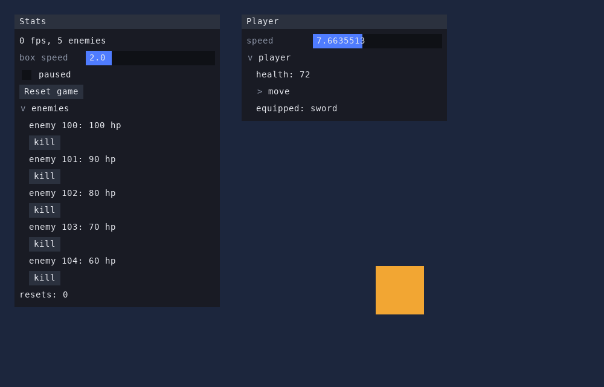

# ui_spike: milestone M0 of `std::ui`

A throwaway immediate-mode UI that tests the parts of [draft 35](../../docs/design/drafts/35-ui.md) which depend on the language, before `std::ui` is built on them ([roadmap](../../docs/design/drafts/35-ui-roadmap.md), M0). It draws flat rectangles and a 9x18 bitmap font; the look is M1's job.

```
edaxc run --root=example ui_spike                            the window (Esc quits)
edaxc run --root=example ui_spike -- --screenshot out.ppm    scripted input, then a screenshot
edaxc test --root=example ui_spike_test                      frames without a window
```



| File | |
|---|---|
| `ui.edh`, `ui.ed` | Context, frame, scopes, ids, widgets (`text`, `button`, `checkbox`, `slider`, `tree`, `id`), `field` and `inspect` from reflection |
| `renderer.edh`, `renderer.ed` | OpenGL 3.3: one shader, one draw call |
| `main.ed` | A "game" with two UI windows over it; `--screenshot` replays input and writes a PPM |
| `test.ed` | Five tests: frames with scripted input, no window |
| `font_9x18.a8`, `make_font.py` | The bitmap font (DejaVu Sans Mono 14 px, printable ASCII, one solid cell) and the script that made it |

## Results

| Question (draft 35) | Result |
|---|---|
| Scopes that borrow their parent mutably (§10.2) | **Works.** Using a window while one of its tree nodes is open, or opening two windows at once, is E5023 at the line. `~scope` pops the layout and sizes the window's background, so nothing has to be "ended" by hand. Code reads like the UI's structure |
| Ids from `implicit compile_time std::call_site` | **Works.** Equal labels in different places are different widgets without `PushID`. In a loop `list.id(key)` separates them; without it the duplicate is counted (test `equal_labels_from_one_call_site_are_reported`). The copies of a `for compile_time` loop share one call site, so `inspect` adds the field name to the id |
| Field names as `compile_time std::static_str` (§7.1, §7.8.1) | **Works.** `w.field(mut a, "volme")` is an error at the call with `@std::diagnostic_frame{ .hide = true }` on `field` (without it, the error points into the library) |
| `inspect` from fields and annotations | **Works.** `@ui::range`, `@ui::hidden`, `@ui::read_only` are read with `f.annotation<A>()` / `f.has<A>()`; nested structs become tree nodes; anything else prints with `{}` |
| `@std::must_use` on `button` | Works: an ignored click is E4150 |
| Input as plain data (`ui::input`) | Works: the tests run frames with no window and no GPU |
| Own widgets with the library's call syntax (open question 2) | **Works after a compiler fix.** An interface of the program plus `implement own_widgets for ui::scope { ... }` makes `w.toggle(...)` possible, with the caller's call site. Methods of `implement` blocks didn't get their `compile_time` / `implicit compile_time` template parameters (E4160 "cannot deduce '?'"); fixed in `resolve.cpp` |
| Rendering through `std::graphics::opengl` | Works; `std::embed` for the font |

### Decisions for draft 35
- **Q2, own widgets:** the library's widgets are methods of `ui::scope`; a program's own widgets are methods of its own interface, `implement`ed for `ui::scope`. No language change needed.
- **Q3, scopes vs. lambdas:** scopes. The borrow errors are exactly the mistakes ImGui makes possible, and blocks keep `return`, `break` and captures-free code.
- **Q4, layout:** one pass. A window reserves its background quad when it opens and moves it to the final size when its scope ends; `fit` sizes from the last frame stay the plan.
- **Q6, where fonts live:** `std::text::font` (beside strings and formatting) and `std::image` as its own module.

### Found on the way
Fixed in this change:
- `resolve.cpp`: members added by `implement` blocks (and by annotations) were resolved without their template scope, so their `compile_time` parameters had no symbols. Test: `tests/action/run/implement_implicit_parameters.ed`.
- `resolve.cpp`: a **qualified** `compile_time` constant as a template value argument (`gl::functions<ui::gl_33>`, also through a namespace alias) was read as a type (E3022). Test: `tests/action/run/qualified_value_arguments.ed`.
- `example/windowing` didn't build any more since the implicit-members rule (E3028 for locals named like fields, E3026 for `vulkan`); renamed the locals and qualified `demo::vulkan`.

For later milestones:
- **std, M1/M2:** no way to format into an existing string (`std::format_into(mut string&, args)`), so `text(f"...")` allocates once per call; `std::span<T>` has no `as_ptr()`; reading a byte of a `std::str` needs `unsafe`.
- **Naming, M2:** the implicit-members rule makes method and field names of `ui::scope` unusable as local names in its methods (`id`, `size`, `in` here). The real API should keep its method names apart from the names its own code wants for locals.
- **Compiler messages:** the instance name in "in the instance ..." notes prints the whole `std::call_site` struct; the E5023 note about atomics and mutexes also shows in single-threaded code.
